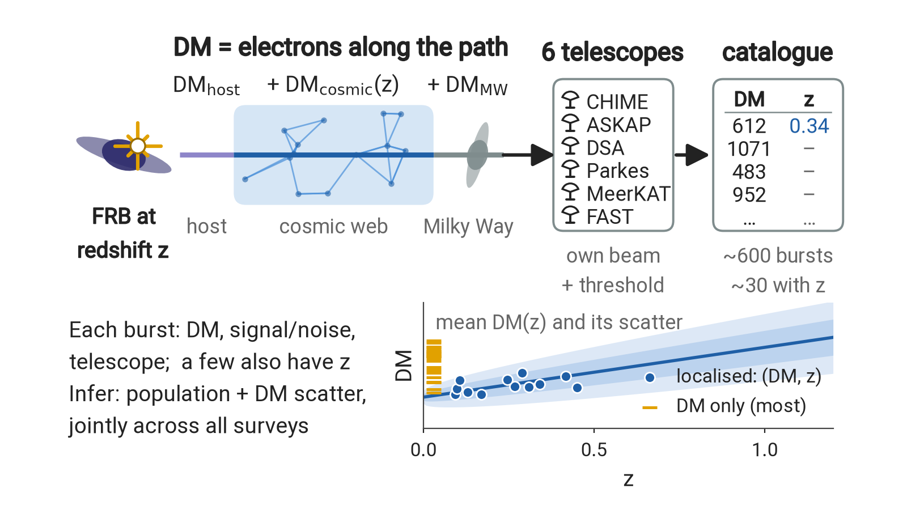
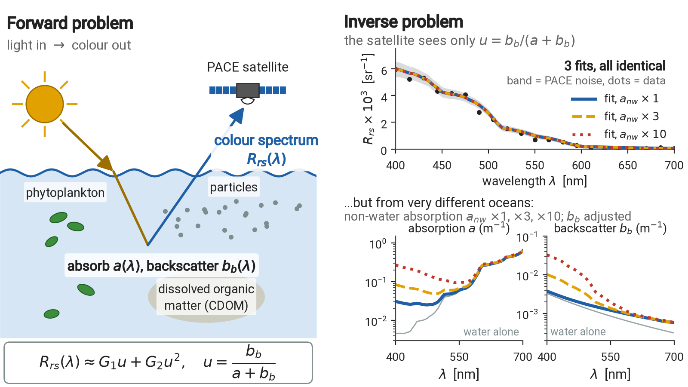

# Advancing science on the frontier with modern statistical techniques

J. Xavier Prochaska (UC Santa Cruz) · host: Prof. Yunyi Shen

This talk asks you for better methods. I will present two inference problems, one in astrophysics and one in ocean science. Each has a working Bayesian solution that is too slow, too prior-dependent, or both. For each I will lay out the data, the model and the likelihood we use now, then stop where we are stuck. Ideas from any corner of statistics are welcome, classical or modern, machine learning and AI included; data and code are public.

|  |  |
|:--|:--|
| *A burst at redshift z picks up dispersion measure (DM) in its host galaxy, the cosmic web and the Milky Way. Six telescopes with different beams and thresholds detect ~600 bursts, all with DM but only ~30 with z. The population model is fit to all surveys jointly.* | *Sunlight absorbed (a) and backscattered (b_b) by seawater and its contents sets the colour spectrum R_rs(λ) seen by PACE. But R_rs depends only on b_b/(a+b_b), so very different oceans give spectra that are indistinguishable within the noise.* |

## 1. Fast radio bursts: one population, many telescopes

**Goal.** A fast radio burst is a millisecond flash of radio waves from a distant galaxy. We want the population's properties (energies, repetition) and, through them, the expansion rate of the Universe, H0.

**Data.** Each burst gives a dispersion measure DM, the column density of free electrons along the path, from the delay of low frequencies behind high ones. The redshift z (distance) is known only when the host galaxy is identified. About 600 bursts from six telescopes, a few dozen with z; each telescope has its own beam and threshold, so each survey is a differently censored draw from one population.

**Model.** DM is a sum of parts:

    DM = DM_MW + DM_cosmic(z) + DM_host / (1 + z)

DM_MW is known; DM_cosmic given z is skewed, with mean growing with z and fractional width ∝ F/√z; DM_host is lognormal(μ_host, σ_host). Bursts in survey s form an inhomogeneous Poisson process on the (z, DM) plane:

    λ_s(z, DM | θ) = [rate density] × [cosmic volume at z] × [source evolution ∝ (star-formation history)^n_sfr] × p(DM | z) × P_s(detected | z, DM, θ)

The last factor is the fraction of the burst energy function (power law, slope γ, exponential cutoff E_max) above the survey threshold, averaged over beam and burst width. θ has about 12 parameters (H0, E_max, γ, n_sfr, μ_host, σ_host, repetition terms). Each source's bursts are Poisson with a power-law distribution of rates, so the model also predicts how many sources are seen once versus repeatedly.

**Likelihood.** Localized bursts enter with full density, DM-only bursts with z marginalized, Λ_s = ∫∫ λ_s dz dDM:

    ln L(θ) = Σ_s [ Σ_i ln( λ_s(z_i, DM_i) / Λ_s ) + Σ_j ln( ∫ λ_s(z, DM_j) dz / Λ_s ) ] + Poisson terms for the counts

plus a term per burst for its signal-to-noise; the overall rate is profiled out.

**Current method.** λ_s on a 500 × 1400 (z, DM) grid per survey, rebuilt at every likelihood call; uniform priors; emcee with 40 walkers × 2000 steps takes about a week on a cluster, so longer chains are out of reach.

**Where we want help.**
- Faster inference: emulators, surrogate likelihoods, samplers that need fewer calls.
- Strong degeneracies (e.g. H0 with E_max) make the posteriors prior-sensitive.
- Choosing among competing energy-function forms: evidence, information criteria, or better.

## 2. Ocean colour: what is in the water?

**Goal.** Ocean colour seen from space encodes what is in the upper water: phytoplankton, dissolved organic matter and other particles, which matter for the carbon cycle. We want to infer them, with uncertainties, from the spectrum.

**Data.** NASA's PACE satellite (2024) measures the remote-sensing reflectance R_rs(λ), light leaving the water over incoming sunlight, from the ultraviolet to the near-infrared (340 to 890 nm in 5 nm steps, 100+ channels where earlier satellites had 6 to 10). Global coverage every 1 to 2 days at 1 km: millions of spectra per day, each with per-wavelength errors. For development: 3,320 simulated spectra (Loisel et al. 2023) with known truth and realistic noise; next, real PACE spectra matched to robotic BGC-Argo float measurements.

**Model.** Absorption a(λ) and backscattering b_b(λ), both in m⁻¹, set the colour (Gordon et al. 1988):

    u = b_b / (a + b_b),   r_rs = G1·u + G2·u²,   R_rs = 0.52 r_rs / (1 − 1.7 r_rs)

with G1 = 0.0949, G2 = 0.0794. Each is a known pure-water part plus a non-water part (a = a_w + a_nw, b_b = b_b,w + b_b,nw); the non-water parts take nested parametric forms with k = 2 to 5 parameters, e.g.

    a_nw(λ) = A_dg·exp[−S_dg(λ − 400)] + A_ph·a_ph(λ),   b_b,nw(λ) = B_nw·(λ/600)^β

Priors: log-uniform amplitudes, uniform S_dg ∈ [0.01, 0.02] nm⁻¹ and β ∈ [0, 2], optionally informative. Likelihood: Gaussian, independent across wavelengths:

    ln L = −½ Σ_λ [R_rs,obs(λ) − R_rs,model(λ; θ)]² / σ²(λ)

The crux: R_rs depends on a and b_b only through u, so they are not separately identifiable. Only the water terms and the priors break the degeneracy, and the data support just a few non-water parameters.

**Current method.** emcee per spectrum (about 75,000 steps); models compared by BIC = k ln n − 2 ln L from a Levenberg-Marquardt best fit.

**Where we want help.**
- Proper Bayesian evidence for the nested models instead of BIC from a point estimate.
- Informative priors break the degeneracy but bias the answer; how to choose or learn them, perhaps hierarchically.
- Scale: per-pixel MCMC cannot handle millions of spectra a day; amortized or simulation-based inference with calibrated posteriors.

## Code and papers

- FRBs: Hoffmann, James, Prochaska, Pastor-Marazuela, Sharma & Connor 2026, arXiv:2609.27282. Code: github.com/FRBs/zdm
- Ocean colour: Prochaska & Frouin 2025, Biogeosciences 22, 4705–4728, doi:10.5194/bg-22-4705-2025. Code: github.com/ocean-colour/bing (BING, Bayesian INferences with Gordon coefficients)

## Contacts

- J. Xavier Prochaska, UC Santa Cruz (jxp@ucsc.edu)
- Clancy James, Curtin University (FRBs)
- Robert Frouin, Scripps Institution of Oceanography (ocean colour)
